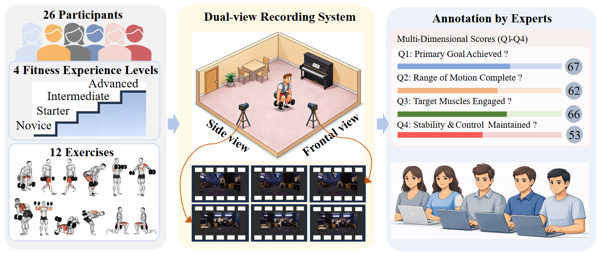
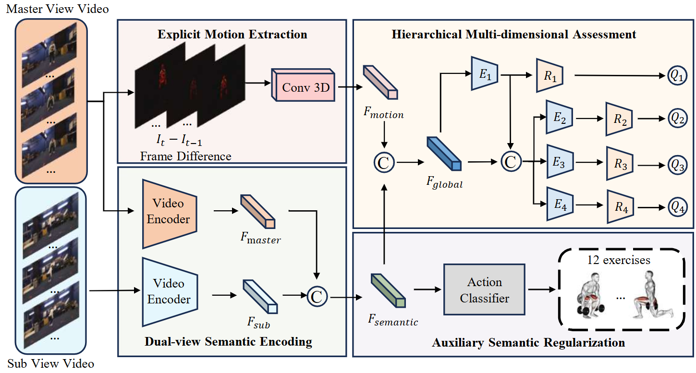

# HomeFit-MD
This is the code for "HomeFit-MD: Expert-Perceived Multi-Dimensional Action Quality Assessment for Home-based Exercises".

## 12 Exercises


## Dataset



- The HomeFit-MD dataset can be download from the [Google Drive](https://drive.google.com/file/d/1kcBtKZLmw7asiUJj8ZiF9Nd1c5Xsp2hI/view?usp=sharing).


## Framework



## Training and Evaluation
- Train the model:
```
python HomeFitNet.py 
```
The training script evaluates the held-out participants (IDs 8, 12, 18, and 23) after each epoch and saves the best checkpoint.

- Evaluate the provided best checkpoint:
```
python HomeFitNet_inference.py
```

## Citation

Please cite this work if you find it useful.

## Contact

If you have any questions, please feel free to contact GeY20@cardiff.ac.uk


